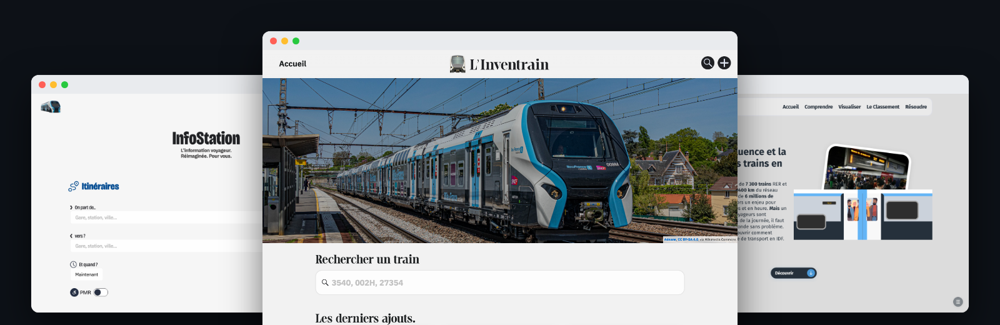

# Léo Lesimple

Étudiant en BUT MMI, en Île-de-France. Web, design, et transports franciliens.

## Projets

- [InfoStation](https://infostation.fr) : voyagez en Île-de-France simplement avec des données en temps réel.
- [L'Inventrain](https://linventrain.leolesimple.fr) : une base de données interactive sur le matériel ferroviaire francilien.
- [Flucilien](https://flucilien.leolesimple.fr) : un outil de visualisation de l'affluence des gares ferroviaires en IDF.
- [LOTY](https://getloty.fr/) : un MVP de planification de repas sous forme de Bento.
- [icloud-mail-mcp](https://github.com/leolesimple/icloud-mail-mcp) : un serveur MCP (Model Context Protocol) qui permet à une IA de lire, rechercher et envoyer des mails iCloud via IMAP/SMTP.

## Contact

[leolesimple.fr](https://leolesimple.fr) · [LinkedIn](https://www.linkedin.com/in/TODO)
